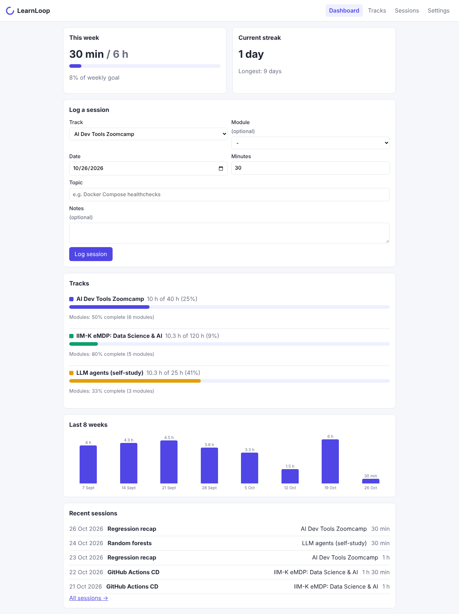
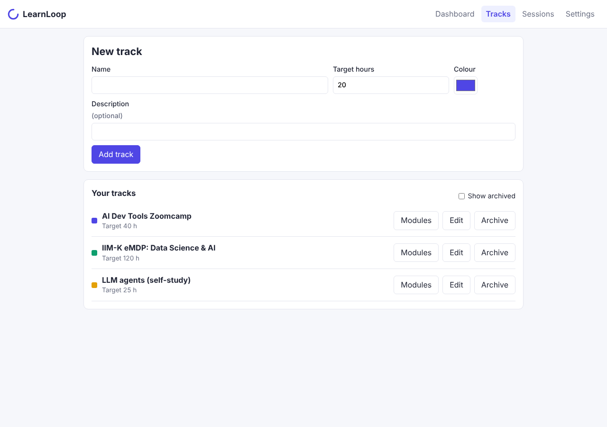
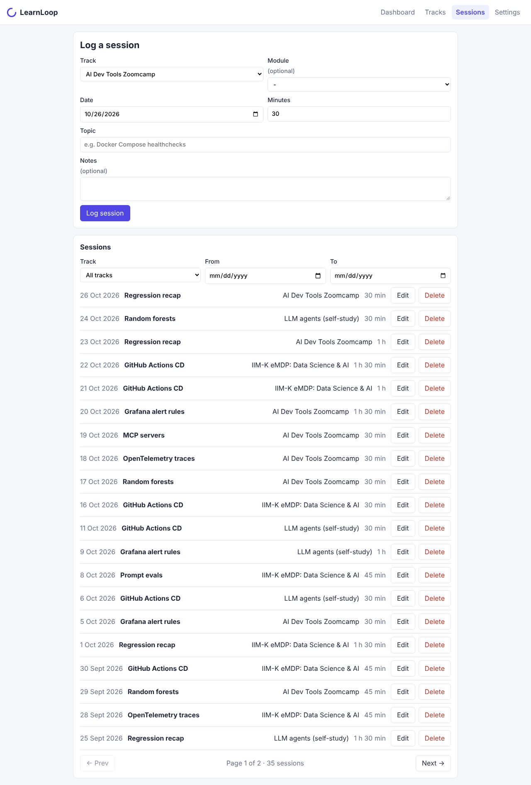
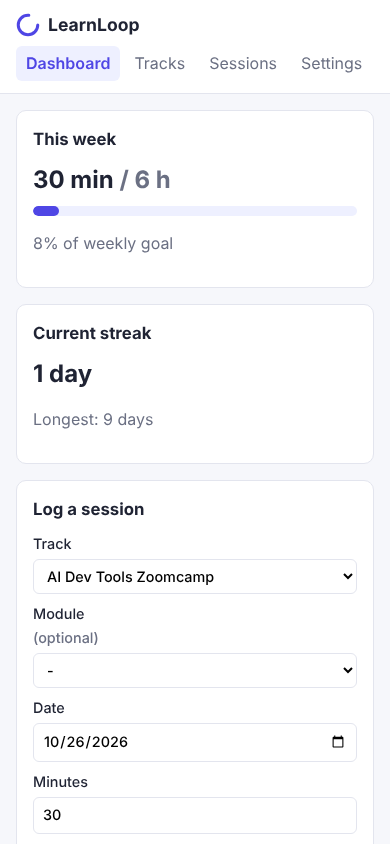

# LearnLoop — personal learning dashboard

Final project for the [AI Dev Tools Zoomcamp 2026](https://github.com/DataTalksClub/ai-dev-tools-zoomcamp).
LearnLoop is one small full-stack app taken all the way to production: spec → tracker → agent team → code → tests → containers → CI/CD (dev → manual prod, with rollback) → observability → user-impact alerts → an on-call agent that fixes the bug.



## Problem

Working professionals who are upskilling, for example an engineering manager doing an AI programme alongside a part-time course, learn in short sessions spread over months. They use several sources (courses, books, side projects), and it is hard to answer simple questions about their own progress:

- How many hours did I put in this week, and is that on target?
- Which track am I neglecting?
- How much of each course have I actually finished?
- Am I keeping a regular habit, or studying in bursts?

Spreadsheets and notes apps can store the raw data, but they don't turn it into a quick progress view. So people lose momentum without noticing.

## What LearnLoop does

A single-user web app:

1. **Tracks:** create learning tracks (e.g. "AI Dev Tools Zoomcamp", "IIM eMDP – Data Science & AI"), each with a target in hours and a colour. Tracks can be archived.
2. **Modules:** break each track into ordered modules marked *not started*, *in progress* or *done*.
3. **Study sessions:** log a session with its date, minutes, track, an optional module, a topic and notes. Sessions can be edited, deleted, filtered and paged.
4. **Dashboard:** see at a glance:
   - hours this week against your weekly goal
   - your current and longest streak
   - hours per track against its target, plus module completion %
   - the last 8 weeks as a bar chart
   - recent sessions
   - an empty state on first use
5. **Settings:** weekly goal, timezone (all date maths uses it) and whether the week starts on Monday or Sunday.

**Expected behaviour:** a logged session shows up on the dashboard straight away, the totals are correct across month, year and timezone boundaries, and data persists across restarts and deploys. The full behaviour and acceptance criteria (AC1.1–AC5.1) are in [`product-spec.md`](product-spec.md).

| Tracks & modules | Sessions | Mobile |
|---|---|---|
|  |  |  |

## Architecture

```
Browser ──► FastAPI (/api/*, serves the built React UI) ──► PostgreSQL
               │  OpenTelemetry SDK: traces, metrics, JSON logs (shared trace_id)
               ▼
         OTel Collector ──► Prometheus (metrics) / Tempo (traces) / Loki (logs) ──► Grafana
                                                                    │ user-impact alerts
                                                                    ▼
                                            On-call responder (:8001) ──► Claude Code (headless)
                                                                    │ diagnose → test → fix → incident report
```

| Layer | Tech | Where |
|---|---|---|
| Frontend | React 19 + Vite, react-router, Vitest + Testing Library. All calls go through `src/api/client.js` | [`frontend/`](frontend/) |
| API contract | OpenAPI 3.1, linted with Redocly; a contract test keeps the backend in sync | [`openapi.yaml`](openapi.yaml) |
| Backend | FastAPI, SQLAlchemy 2, Pydantic 2, `uv`, pytest, ruff | [`backend/`](backend/) |
| Database | PostgreSQL 16 (SQLite only for fast unit tests) | `docker-compose.yml` |
| Containers | Multi-stage Dockerfile (UI build → slim Python runtime, non-root, healthcheck); Compose for the app and test stacks | [`Dockerfile`](Dockerfile), [`docker-compose.yml`](docker-compose.yml), [`docker-compose.test.yml`](docker-compose.test.yml) |
| CI/CD | GitHub Actions: PR checks → GHCR image → auto-deploy **dev** → **manual approval** → prod; rollback workflow | [`../.github/workflows/project-1-cicd.yml`](../.github/workflows/project-1-cicd.yml), [`project-1-rollback.yml`](../.github/workflows/project-1-rollback.yml) |
| Hosting | Render web services (dev + prod) running the GHCR image; managed Postgres per environment | [`docs/deployment.md`](docs/deployment.md) |
| Observability | OTel → Collector → Prometheus / Tempo / Loki → Grafana (provisioned dashboard, datasources and alerts) | [`ops/observability/`](ops/observability/) |
| On-call | Webhook responder that gathers telemetry and runs Claude Code headless with a tool allowlist | [`ops/oncall/`](ops/oncall/), [`ops/runbook.md`](ops/runbook.md) |

More detail: [`docs/architecture.md`](docs/architecture.md).

## Quick start

Prerequisites: Docker Desktop. For the dev workflow, also Python 3.12 + [uv](https://docs.astral.sh/uv/) and Node 22.

```bash
cd Project-1
docker compose up --build
```

| What | URL |
|---|---|
| LearnLoop UI + API | http://localhost:8000 (API docs at `/docs`) |
| Grafana (admin / admin) | http://localhost:3001 → dashboard **LearnLoop – Key journey** |
| Prometheus | http://localhost:9090 |

Stop it with `docker compose down`. Add `-v` to also delete the data.

### Develop without Docker

```bash
cd backend && uv sync && uv run uvicorn learnloop.main:app --reload --port 8000   # SQLite by default
cd frontend && npm install && npm run dev                                         # http://localhost:5173
```

## Tests

Run the whole suite with one command. It runs backend lint, 74 unit tests, integration tests on a real Postgres, and frontend lint plus 31 tests:

```bash
docker compose -f docker-compose.test.yml up --build --abort-on-container-exit --exit-code-from tests
# shortcuts: .\scripts\test.ps1 (Windows) | ./scripts/test.sh | make test
```

| Suite | What it covers | Run individually |
|---|---|---|
| Backend unit | Every acceptance criterion, date and streak maths (month/year/leap/timezone), validation, write-token auth, a contract test against `openapi.yaml`, and a telemetry test that checks for a shared trace_id and no PII | `cd backend && uv run pytest` |
| Backend integration | The key journey end to end on PostgreSQL, persistence across app restarts, Postgres-specific behaviour (`tests/integration`, marker `integration`) | `cd backend && INTEGRATION_DATABASE_URL=postgresql+psycopg://… uv run pytest -m integration` |
| Frontend | API client, formatting, session form, dashboard (empty state, re-fetch after logging), tracks, settings, trend chart | `cd frontend && npm test` |
| On-call agent | Webhook parsing, dedupe, busy guard, prompt, tool allowlist | `cd ops/oncall && uv run pytest` |

## Deployment and CI/CD

- **Every PR:** the backend, integration, frontend and contract jobs plus a Docker build run.
- **Merge to `main`:** the image `ghcr.io/ashish-srivastava1/learnloop:<sha>` is pushed, deployed automatically to **dev**, and smoke-tested (`/health`, `/api/dashboard`).
- **Production:** the same image is promoted to **prod** after a manual approval on the `production` GitHub environment.
- **Rollback:** run *Project-1 rollback* with an older SHA, or use Render's rollback. See [`ops/rollback.md`](ops/rollback.md).

| Environment | URL |
|---|---|
| dev | _add after first deploy_ |
| prod | _add after first deploy_ |

One-time setup (Render services, databases, secrets, environments): [`docs/deployment.md`](docs/deployment.md).

## Observability, alerting and on-call

- **Key journey:** open the dashboard → log a session → the dashboard updates. It's instrumented with FastAPI and SQLAlchemy spans, request count and latency histograms (`learnloop_http_requests_total`, `learnloop_http_request_duration_seconds`), a business counter (`learnloop_sessions_logged_total`), and JSON logs carrying the same `trace_id`. Topics, notes, tokens and the DB URL are never recorded, and a unit test enforces this.
- **Alerts on user impact, not CPU:**
  - more than 5 % 5xx on `POST /api/sessions` + `GET /api/dashboard` over 5 minutes
  - p95 latency above 1 s
- **On-call agent:** Grafana's webhook wakes `ops/oncall/responder.py`. It gathers metrics, logs and traces for the alert window, then runs Claude Code headless with a tool allowlist. The agent reproduces the problem with tests, fixes the code, runs the suite and writes `ops/incidents/<id>/incident.md`. With `ONCALL_GIT=1` it also opens a bug issue and a fix PR.
- **Demo** (full script in [`ops/runbook.md`](ops/runbook.md)):
  ```bash
  docker compose up --build -d
  cd ops/oncall && uv run uvicorn responder:app --host 0.0.0.0 --port 8001      # separate terminal
  python ops/chaos/inject_bug.py && docker compose up --build -d app            # break the dashboard
  python ops/chaos/traffic.py -n 120 --delay 0.5                                # users hit it → alert fires
  ```
- **Evidence:** recorded agent runs are in [`ops/incidents/`](ops/incidents/).

## How it was built (AI-assisted workflow)

- **Spec first:** the problem, features, acceptance criteria and NFRs went into [`product-spec.md`](product-spec.md) before any code was written.
- **Public task tracker:** [project board](https://github.com/users/ashish-srivastava1/projects/1) and [issues labelled `project-1`](https://github.com/ashish-srivastava1/ai-dev-tools-zoomcamp/issues?q=label%3Aproject-1). The backlog was seeded by [`scripts/create-issues.ps1`](scripts/create-issues.ps1) from [`docs/backlog.md`](docs/backlog.md). Each issue has acceptance-criteria checkboxes, and each commit references its issue (`Closes #n`).
- **Agent team:** [`docs/agent-team.md`](docs/agent-team.md) defines the roles (product, planner, backend, frontend, tester, reviewer, DevOps, on-call) and how they hand off through GitHub issues. Role prompts are in [`.claude/agents/`](.claude/agents/). The frontend, DevOps, CI/CD and on-call work ran as parallel agents, each owning separate files, and the lead integrated, reviewed and verified the result.
- **Context management:** [`AGENTS.md`](AGENTS.md) is the short entry point, with hard rules and commands. It links to modular docs: process, agent team, architecture, deployment and ops.

## Rubric map

| Criterion | Evidence |
|---|---|
| Problem description | This README, [`product-spec.md`](product-spec.md) |
| Product specification | [`product-spec.md`](product-spec.md) + [public board](https://github.com/users/ashish-srivastava1/projects/1); issues #4–#25 with acceptance criteria, closed by commits and PRs |
| Agent team specification | [`docs/agent-team.md`](docs/agent-team.md), [`.claude/agents/`](.claude/agents/) |
| Context management | [`AGENTS.md`](AGENTS.md) → [`docs/`](docs/), [`ops/README.md`](ops/README.md) |
| Application | `docker compose up --build` → UI + API + Postgres |
| Testing | Unit + integration + frontend tests, one command (see [Tests](#tests)) |
| Containerization | [`Dockerfile`](Dockerfile), [`docker-compose.yml`](docker-compose.yml) (db included) |
| Deployment | Render dev + prod (URLs above), [`docs/deployment.md`](docs/deployment.md) |
| CI/CD | [`project-1-cicd.yml`](../.github/workflows/project-1-cicd.yml): PR tests → auto dev → manual prod; [`project-1-rollback.yml`](../.github/workflows/project-1-rollback.yml) |
| Observability | [`backend/src/learnloop/telemetry.py`](backend/src/learnloop/telemetry.py), [`ops/observability/`](ops/observability/) |
| Alerting on user impact | [`alert-rules.yaml`](ops/observability/grafana/provisioning/alerting/alert-rules.yaml) |
| On-call agent | [`ops/oncall/`](ops/oncall/), [`ops/incidents/`](ops/incidents/) |

## Repository layout

```
Project-1/
├── README.md, product-spec.md, AGENTS.md, openapi.yaml, redocly.yaml
├── backend/            FastAPI app (src/learnloop) + tests (unit, integration)
├── frontend/           React + Vite UI + Vitest tests
├── Dockerfile, docker-compose.yml, docker-compose.test.yml, Makefile
├── scripts/            test runners, create-issues.ps1
├── docs/               process, agent team, architecture, deployment, backlog, images
├── ops/                observability, oncall, chaos, runbook, rollback, incidents
└── .claude/agents/     role prompts for the agent team
```
